# Лабораторная работа №6. Система контроля версий

**Цель работы:** изучение базовых возможностей системы управления версиями, опыт работы с Git Api, опыт работы с локальным и удаленным репозиторием.

---

## Ход выполнения работы

### 1. Создание аккаунта и копирование репозитория (Fork)
Был создан аккаунт на GitHub. Выполнен форк репозитория `https://github.com/Kurtyanik/LR6/`.

**Скриншот #1**
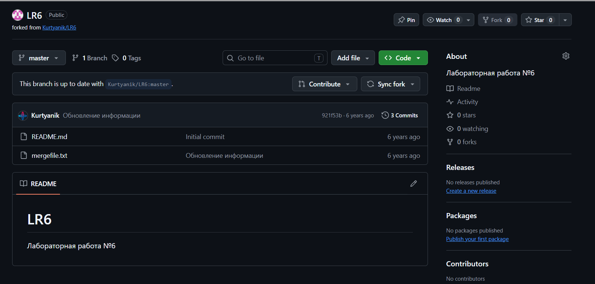

### 2. Установка и настройка Git, клонирование
Git был установлен. Клонирование личного удаленного репозитория на компьютер:

**Скриншот #2**
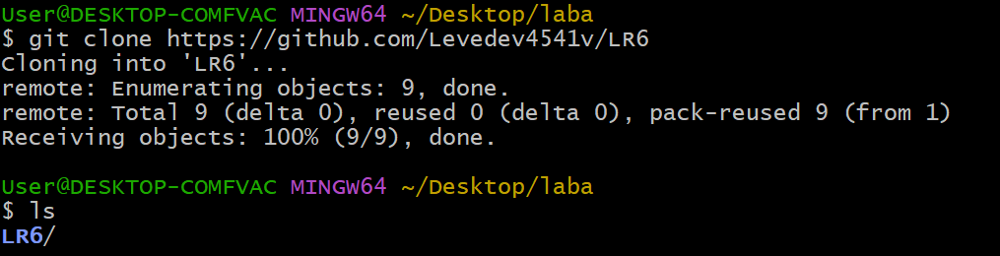

Настройка клиента Git (имя пользователя и email) локально для данного репозитория:

**Скриншот #3**
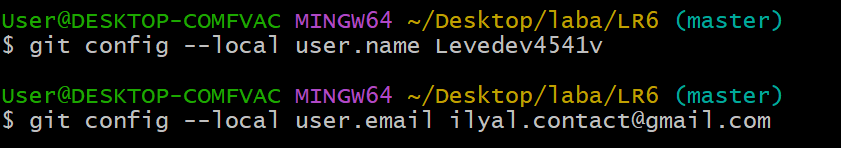

### 3. Добавление файла через интерфейс GitHub
Через веб-интерфейс GitHub в ветку `master` был добавлен новый файл `text_file.txt`.

**Скриншот #4**
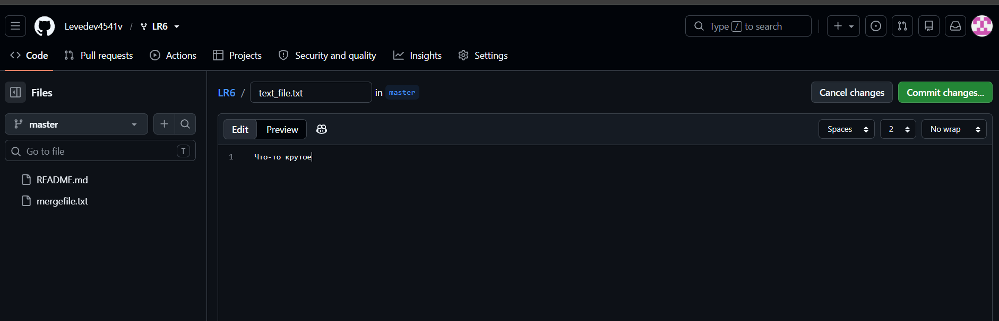

Подтягивание изменений в локальный репозиторий с помощью `git pull`:

**Скриншот #5**
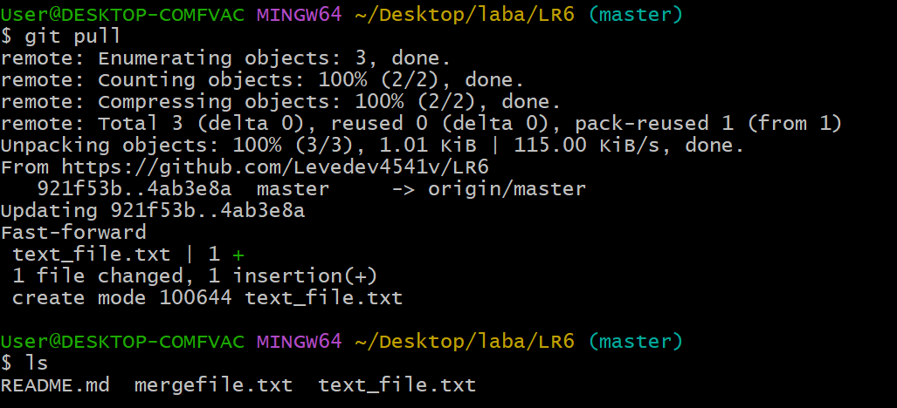

### 4. История операций и последние изменения
Просмотр истории коммитов с помощью `git log`:

**Скриншот #6**
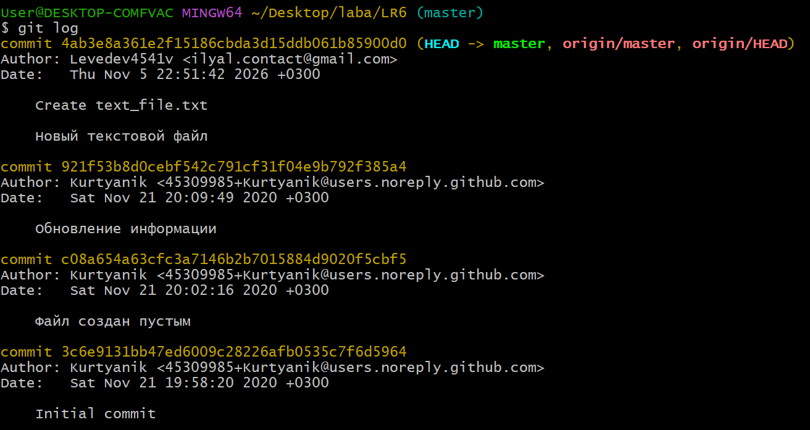

Просмотр последних изменений с помощью `git show`:

**Скриншот #7**
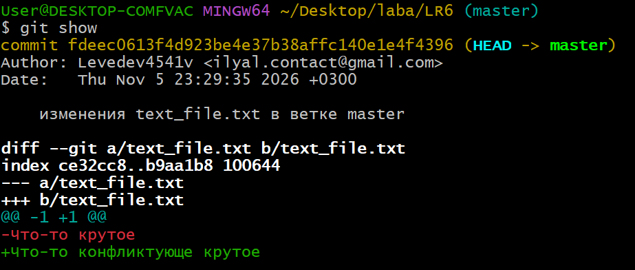

### 5. Ветки и слияние с конфликтом
Создана новая ветка `new_branch` и выполнен переход в неё:

**Скриншот #8**
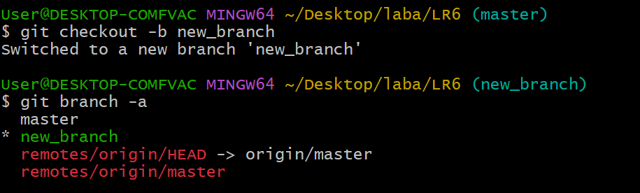

Просмотр истории для ветки `master`:

**Скриншот #9**
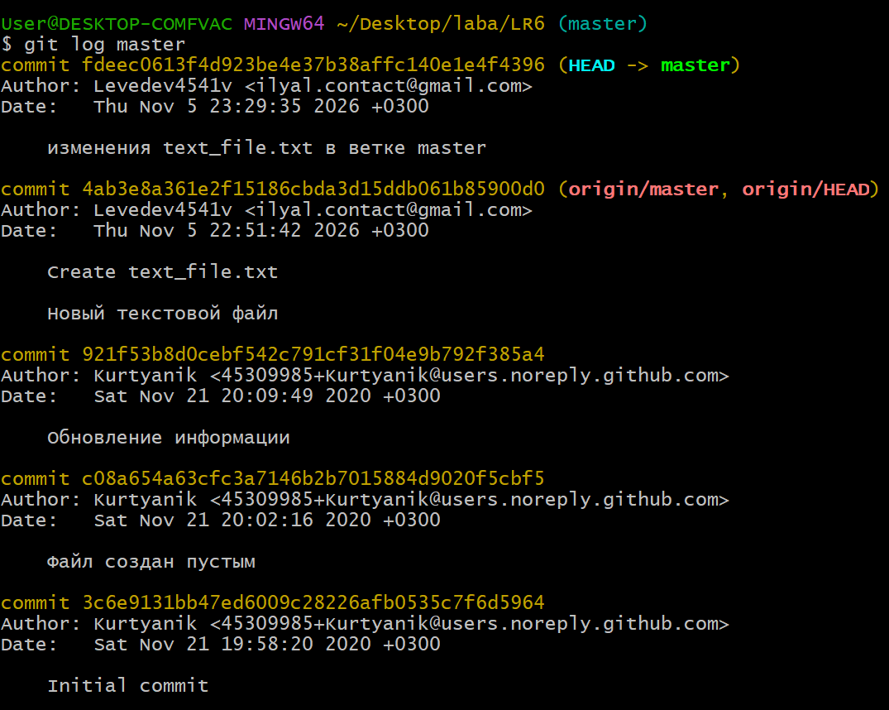

Просмотр истории для ветки `new_branch`:

**Скриншот #10**
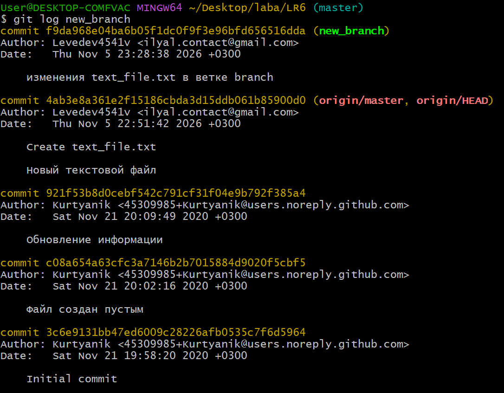

Выполнено слияние ветки `new_branch` в `master`. Возник конфликт, который был разрешен вручную через текстовый редактор `nano`

**Скриншот #11**
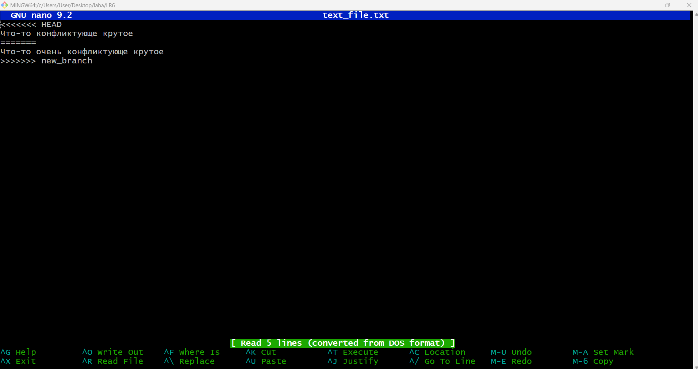

Добавление файла в индекс и фиксация разрешения конфликта:

**Скриншот #12**
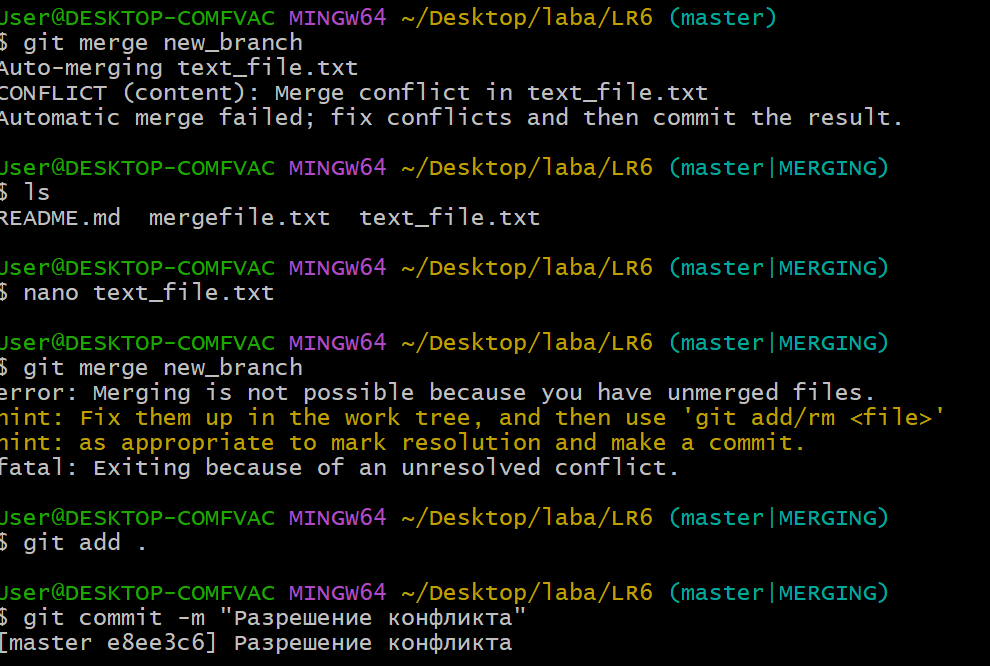

Граф истории после успешного слияния:

**Скриншот #13**
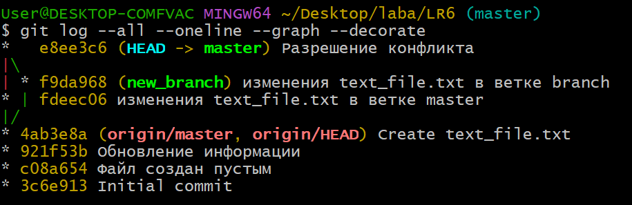

### 6. Внесение изменений и откат коммита
Было сделано три изменения с фиксацией в коммитах («первое изменение», «второе изменение», «третье изменение»):

**Скриншот #14**
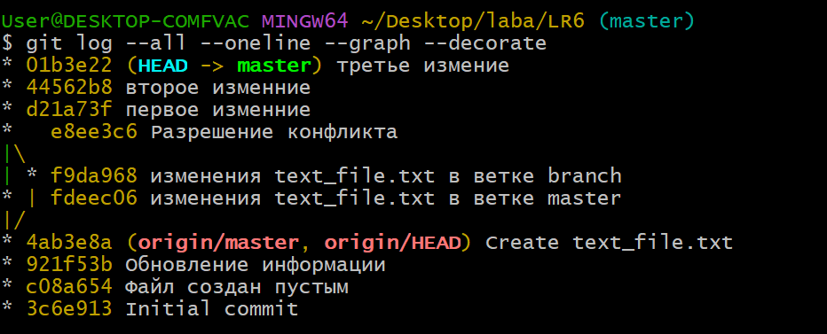

Для отката коммитов был использован `git reset --hard` до коммита с разрешением конфликта.

**Скриншот #15**
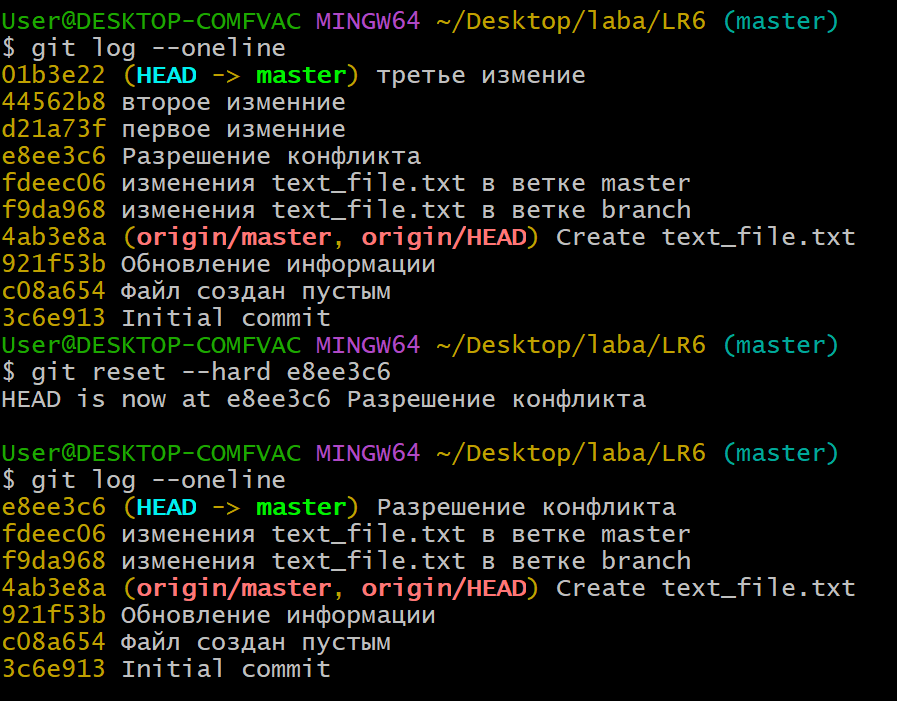

### 7. Создание ветки для отчёта
Создана ветка `report_for_lab` для оформления текущего отчета:

**Скриншот #16**
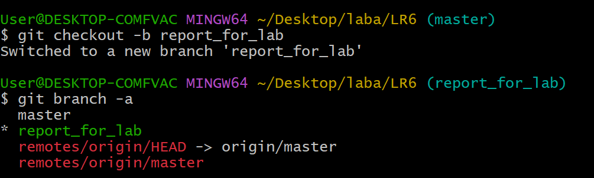

### 8. Получение форматированной истории операций
История операций в форматированном виде:

**Скриншот #17**
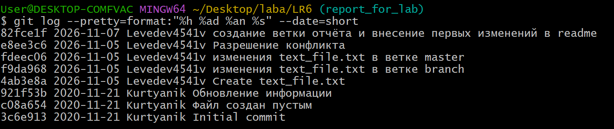

### Лог команд

Лог команд (без результатов их выполнения) сохранен в отдельном текстовом документе в корне репозитория: **log.txt**.

---
